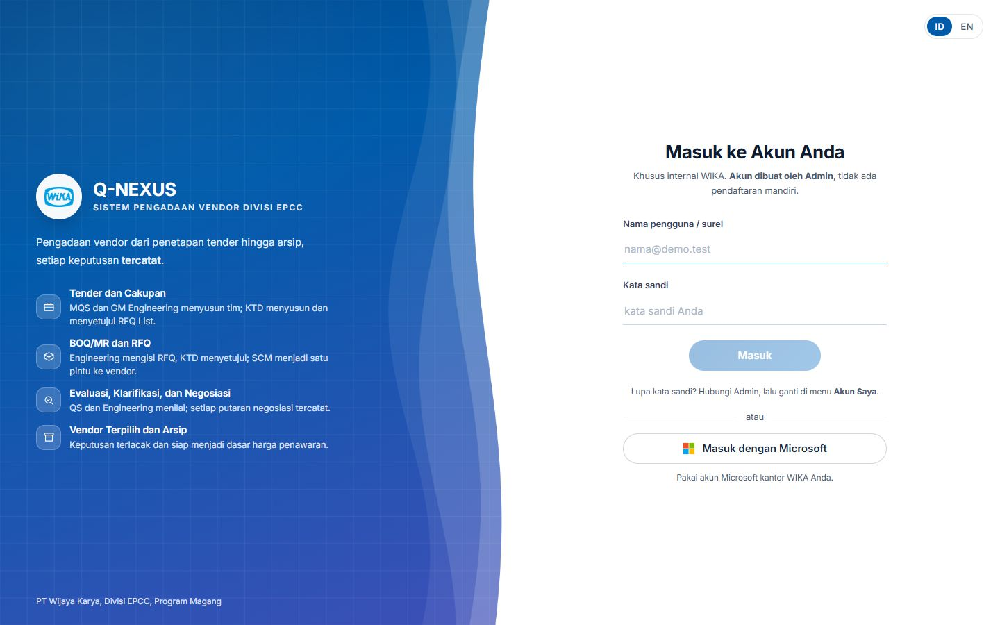

<!-- Showcase repository: the product is real and in use, its source code is private. -->

<a href="https://q-nexus.epccwika.tech"><picture><source media="(prefers-color-scheme: dark)" srcset="assets/banner-dark.svg"></picture></a>

<a href="https://q-nexus.epccwika.tech"><b>Open q-nexus.epccwika.tech</b></a> · <a href="https://github.com/nugrahalabib">More of my work</a> · <a href="https://nugrahalabib.com">nugrahalabib.com</a> · <a href="mailto:nugrahalabib@gmail.com">Email</a>

## Overview

Q-NEXUS is a web application for the EPCC Division of PT Wijaya Karya. It digitalises the vendor procurement work of the quantity surveying team inside the tender stage: tender, BOQ, RFQ, quotations, technical and commercial evaluation, clarification, negotiation, selected vendor and archive.

It serves ten roles, from the tender team lead and QS to engineering, supply chain, management and read-only observers. Each role gets its own dashboard and only the actions it may take.

Reading vendor offers is the hard part. Excel offers are parsed by code with no AI. PDF and Word offers are read by an AI agent, and every number it returns must be proven present in the document.

| | |
| --- | --- |
| **Status** | Live at [q-nexus.epccwika.tech](https://q-nexus.epccwika.tech) |
| **Role** | Designed, built and led by Nugraha Labib Mujaddid, IT Specialist at the EPCC Division of PT Wijaya Karya (Persero) Tbk. |
| **Period** | Since 2026 |
| **Source** | Private. This repository presents the product; the code is not published. |

<picture><source media="(prefers-color-scheme: dark)" srcset="assets/features-dark.svg"></picture>

Features as text

- **Tender to RFQ list.** A tender registry with schedule and team, and an RFQ list that passes an approval gate before anything goes out.
- **BOQ versions.** Bill of quantities in numbered revisions, with Excel import. RFQs and quotations are tied to the version they priced.
- **Reading vendor offers.** Excel is parsed without AI. An AI agent reads PDF and Word, and each number must be found in the document or it is rejected.
- **Evaluation and recommendation.** A technical evaluation matrix, a commercial evaluation, and a recommendation weighted 60% price and 40% technical.
- **Clarification and closing.** Schedule clarification and negotiation rounds. Closing paths cover re-RFQ, failed, cancelled, merged and reopened archives.
- **Price and vendor databases.** A price database with trends, and a vendor database with categories and a blacklist. Documents live in folders with sharing.
- **Per-user data assistant.** Each user has an AI agent that reads data over read-only MCP, limited to what that user's screen would show.
- **Audit and practice mode.** An immutable audit trail, role dashboards with a TV-mode observer view, and a practice mode that uses synthetic prices.

<picture><source media="(prefers-color-scheme: dark)" srcset="assets/architecture-dark.svg"></picture>

<picture><source media="(prefers-color-scheme: dark)" srcset="assets/stack-dark.svg"></picture>

## Engineering highlights

- A number read from a PDF or Word offer is accepted only if it can be found in the document text.
- The business rules live in a shared core with no browser or Node dependency, so the app and the API apply the same logic.
- Passwords are hashed with scrypt and sessions use opaque tokens stored as hashes, so logging out revokes access at once.
- CI checks types, tests, a migration from zero against the reference schema, lint and the build against a real PostgreSQL.
- The audit trail is immutable and visible to admins only. Practice mode keeps training data apart from real prices.

## Screens

The sign-in page of Q-NEXUS

---

Built by [Nugraha Labib Mujaddid](https://github.com/nugrahalabib). This page describes a private codebase; questions about the product or a demo are welcome at [nugrahalabib@gmail.com](mailto:nugrahalabib@gmail.com).
