<!-- Showcase repository: the product is real and in use, its source code is private. -->

<picture><source media="(prefers-color-scheme: dark)" srcset="assets/banner-dark.svg"></picture>

<a href="https://github.com/nugrahalabib">More of my work</a> · <a href="https://nugrahalabib.com">nugrahalabib.com</a> · <a href="mailto:nugrahalabib@gmail.com">Email</a>

<a href="#the-business">The business</a> · <a href="#product-tour">Product tour</a> · <a href="#for-developers">For developers</a>

## Overview

Q-NEXUS is a web application for the EPCC Division of PT Wijaya Karya. It digitalises the vendor procurement work of the quantity surveying team inside the tender stage: tender, BOQ, RFQ, quotations, technical and commercial evaluation, clarification, negotiation, selected vendor and archive.

It serves ten roles, from the tender team lead and QS to engineering, supply chain, management and read-only observers. Each role gets its own dashboard and only the actions it may take.

Reading vendor offers is the hard part. Excel offers are parsed by code with no AI. PDF and Word offers are read by an AI agent, and every number it returns must be proven present in the document.

| | |
| --- | --- |
| **Status** | Live |
| **Role** | Designed, built and led by Nugraha Labib Mujaddid, Lead AI Engineer for digital transformation in the EPCC Division of PT Wijaya Karya (Persero) Tbk. |
| **Period** | Since 2026 |
| **Source** | Private. This repository presents the product; the code is not published. |

<picture><source media="(prefers-color-scheme: dark)" srcset="assets/features-dark.svg"></picture>

## The business

Q-NEXUS is the web application the EPCC Division of PT Wijaya Karya uses to buy prices from vendors while it prepares a tender. It covers the full vendor procurement inside the tender stage: RFQ List, bill of quantities, requests for quotation, vendor quotations, technical and commercial evaluation, clarification, negotiation, selected vendor and archive, with every file kept in one document explorer per tender. Ten roles work in it, from the tender team leader, quantity surveyors and supply chain to engineering, management and read-only observers; each role sees its own dashboard and only the actions it may take, and Admin can let one person hold several roles. It matters because the vendor prices gathered here become the cost basis of the price Wijaya Karya offers its client. It was designed, built and led by Nugraha Labib Mujaddid, Lead AI Engineer for digital transformation in the EPCC Division of Wijaya Karya.

### The problem

Before Q-NEXUS, the EPCC team asked many vendors for prices, compared them, negotiated and chose a vendor through Excel files, email and WhatsApp. The work was scattered and hard to trace afterwards: which version of the item list a vendor had priced, who sent which letter, and why one vendor was preferred over another.

The stakes are high. In a tender, Wijaya Karya must know the cost of pipes, concrete, pumps and subcontract work before it can price its own bid, so one procurement can involve several disciplines, several vendors and several rounds of revision and negotiation. Price data in a state-owned company is confidential and must not leak.

The scope is deliberate. Q-NEXUS handles the relationship between Wijaya Karya and its vendors inside one tender stage. Writing the budget (RABT), management approval and submitting the bid to the client stay outside the system; the final budget documents are only uploaded as closing files.

### Who uses it

| Role | What they do with it |
| --- | --- |
| **KTT (Tender Team Leader)** | Registers the tender, appoints the MQS and GM Engineering, sets the stage schedule and the budget ceiling, and closes each procurement with its result. |
| **KTD (Design Team Leader)** | Builds and releases the RFQ List for the tender and is the only person who approves an RFQ or returns it for revision. |
| **Engineering** | Fills in the BOQ and vendor attachments, submits them to the KTD, and judges each quotation against the specification. Engineering never sees quoted prices. |
| **SCM (Supply Chain)** | The single door to vendors: sends requests for quotation with the tender team copied, follow-up BOQ revisions, reminders and clarifications, records replies and runs negotiation rounds. |
| **QS (Quantity Surveyor)** | Sets the Initial Price, reviews quotations commercially, validates negotiation rounds, and marks the selected vendor with a written reason. |
| **MQS (QS Manager)** | Sees all tenders and prices, but only writes the QS and SCM side of a team, including the QS and SCM person in charge of each procurement. A role with a single member on the team gets its person in charge automatically. |
| **GM Engineering** | Assembles the KTD and Engineering team and sets the Engineering person in charge; acts as backup for the RFQ List but does not approve RFQs. |
| **Admin** | Manages accounts, the primary role and any additional roles of each person, and reads the global audit trail. Every role except System Admin can be combined. A logged emergency mode, which requires a reason, lets Admin take over Engineering and QS tasks. |
| **Management (SVP, Manager)** | Reads progress across all tenders on an observer dashboard with no write actions. Only the SVP sees the Price Database. |
| **QS Coordinator** | Monitors all tenders, overdue work and the Price Database, without any write rights. |

<picture><source media="(prefers-color-scheme: dark)" srcset="assets/before-after-dark.svg"></picture>

<picture><source media="(prefers-color-scheme: dark)" srcset="assets/journey-dark.svg"></picture>

<picture><source media="(prefers-color-scheme: dark)" srcset="assets/value-dark.svg"></picture>

### Model and status

Q-NEXUS is an internal system of the EPCC Division of PT Wijaya Karya (Persero) Tbk, not a commercial product, so it has no pricing. It runs in production with a real database, connected to Microsoft 365 for document storage in SharePoint and for vendor letters through Outlook.

Adoption is supported inside the product. Since November 2026 a Practice Mode lets any employee start a fictional sample tender in their own browser, take their role's steps with a guide that ticks itself off, and see the result reach the next role, without touching real data or sending email.

## Product tour

### 1. Sign-in, role dashboards and two languages

Accounts are created by Admin; there is no self-registration. After sign-in every role lands on its own dashboard, built around a Needs Your Action list that names the next step and links straight to the place where it is done. Every dashboard panel can be collapsed, and the whole interface switches between Indonesian and English.

- Ten roles; the sidebar only shows the pages a role may use, in the order of that role's daily work
- Needs Your Action list, most urgent on top, with "You are PIC" tags
- MQS and GM Engineering assign persons in charge inline, with team workload in view
- Indonesian and English for every screen, switched from the top bar

Sign-in page in English, with the four parts of the process summarised on the left.

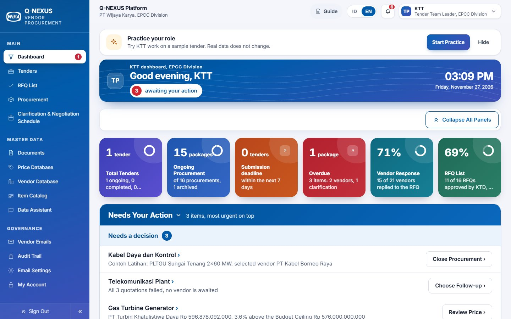 

Left: Tender team leader dashboard: key figures and the decisions waiting for the KTT. · Right: QS Manager dashboard: two procurements without SCM and QS owners, assigned inline.

The procurement list in Indonesian, showing stage, state and deadline per procurement.

### 2. Tender page

A tender is the client's tender; inside it, each procurement is one RFQ. The tender page shows readiness, a stage schedule against the submission deadline, every procurement, the tender documents, the RFQ List summary and the team. Each of its six panels opens and closes from its title, and the choice is remembered per account.

- Readiness checks for team, stage schedule, procurements and documents
- Stage schedule chart with today's line and the submission deadline
- Collapse All Panels; a closed panel keeps its title and a one-line summary, and links open their target panel first
- Tender Team panel names each person's load, the tenders they are in, the procurements they hold and how many are late

Tender page of the practice tender: readiness, stage schedule and tender team.

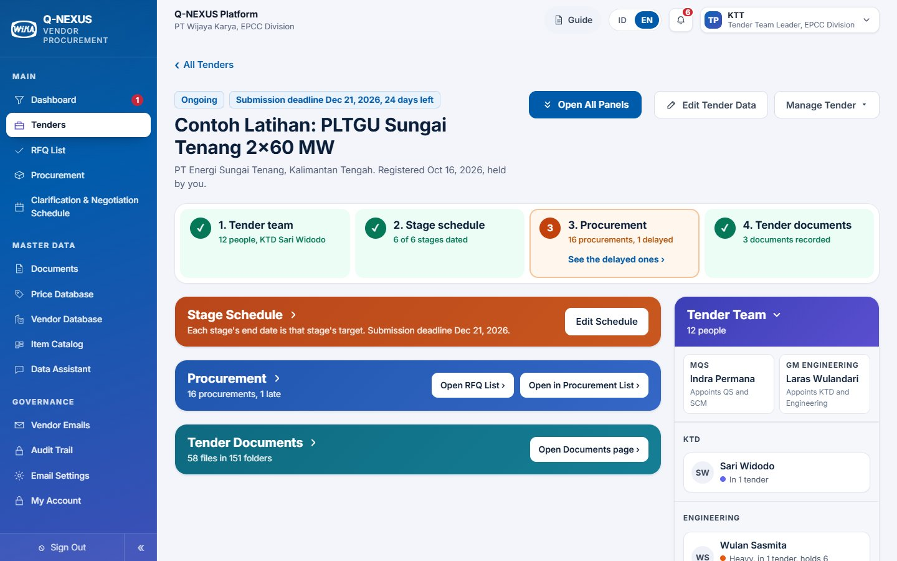 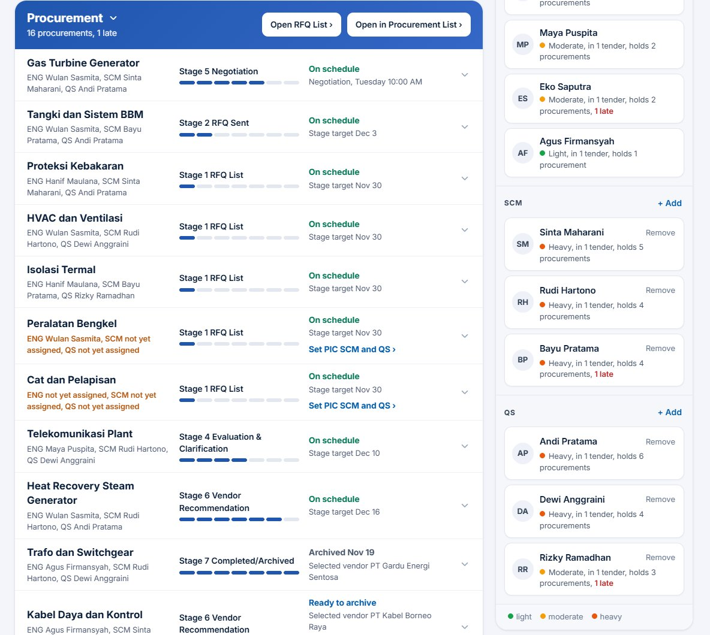

Left: The same page with Stage Schedule, Procurement and Tender Documents closed to their one-line summaries. · Right: Tender Team panel seen by the QS Manager: tenders and procurements held per person, with Add and Remove for the QS and SCM side.

Dashboard view of tender progress across the seven stages and procurement progress per stage.

### 3. RFQ List

The KTD builds the RFQ List, and nothing reaches a vendor until the KTD approves the RFQ. The list is a compact table: one row per RFQ, grouped by state, with a header that stays in view while scrolling, so a tender with many RFQs fits on one screen.

- Groups: awaiting KTD, needs revision, in progress by Engineering, approved and ready to send, sent, completed
- Columns for RFQ number, name and discipline, PIC, target, BOQ state, RFQ state and actions; the KTD's revision note sits under the BOQ state
- On narrow screens the table scrolls sideways inside its panel while the RFQ number and name stay in place
- Progress and Who Is Being Waited On sit under the table; the review window lists BOQ items, attachments and who is notified

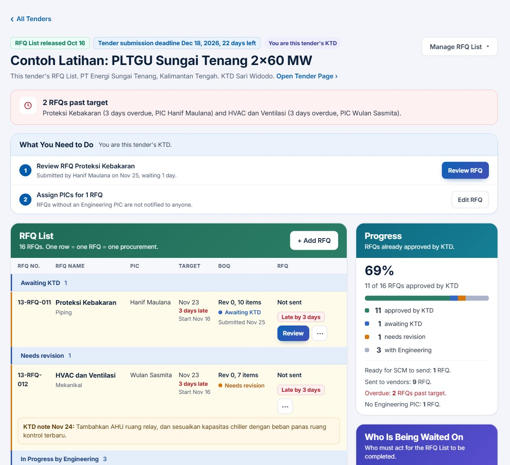

The KTD's RFQ List as a compact table: awaiting KTD, needs revision with the KTD's note, in progress and approved.

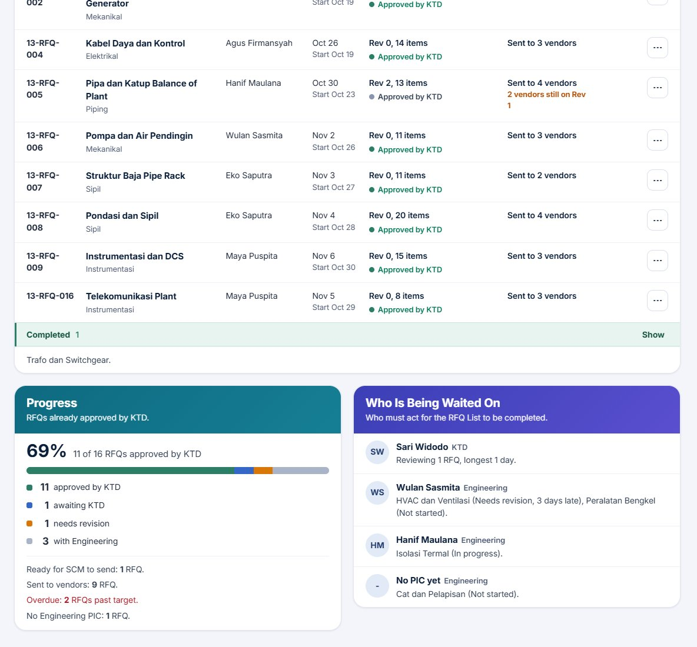 

Left: Bottom of the same list: sent RFQs, then approval progress and who the list is waiting on. · Right: KTD review of one RFQ: BOQ items, the attachment for vendors, and Approve or Request Revision.

### 4. BOQ versions

The bill of quantities often changes after vendors already received it. Q-NEXUS keeps numbered revisions with a required reason, records which revision each quotation answers, and tells SCM which vendors still hold an old version. Sending the new revision lists the changes for the vendor.

- Rev 0 is the BOQ approved by the KTD; later revisions need a reason
- Per-item comparison: volume changed, new item, removed item
- Quotations answering an older revision stay valid but are flagged
- Vendors who declined to quote are skipped when the new revision is sent

BOQ revision history: reason, summary and item-by-item comparison of Rev 1 and Rev 2.

 

Left: Vendor quotations with the notice that two vendors still hold an older BOQ. · Right: Sending BOQ Rev 2: the changes, the receiving vendors and the vendor that was skipped.

### 5. Requests for quotation

Each procurement has one workspace with a seven-stage tracker and a What You Need to Do list for the person signed in. SCM picks vendors in one window: the match follows the category SCM searches for, a second box searches the items a vendor supplies, and the letter goes out with the tender team copied.

- Category filter decides what counts as a match; without one, the procurement's discipline is mapped to a category
- Search material item narrows vendors by the categories and materials they supply, and ranks material matches first
- Blacklisted vendors are hidden and vendors without a valid email cannot be chosen
- Cc prefilled with the sending SCM, the RFQ creator, the KTD, the QS PIC and the KTT; editable, at most 10, invalid addresses refused

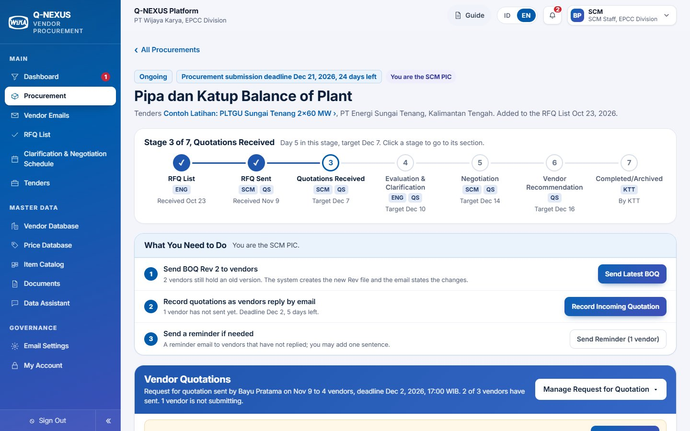

Procurement workspace: stage tracker and the SCM's three next steps.

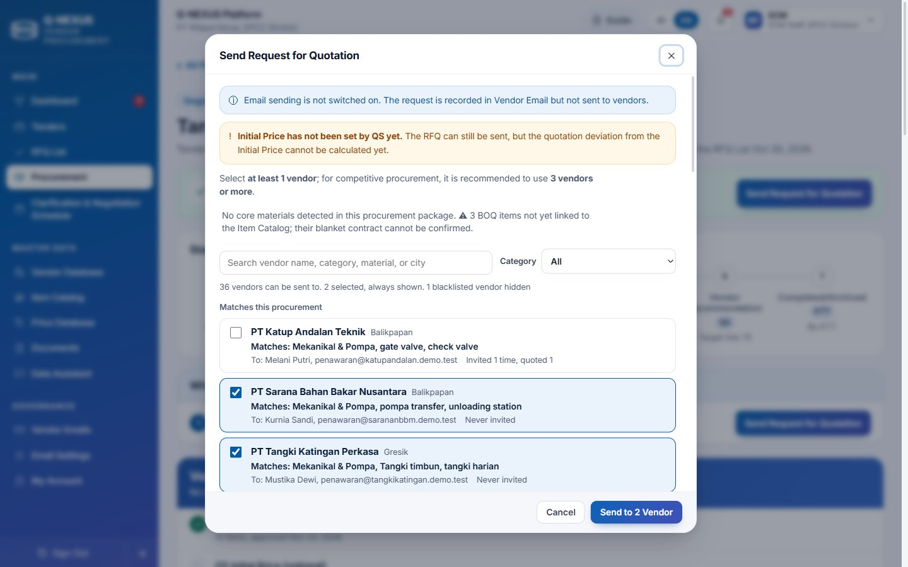 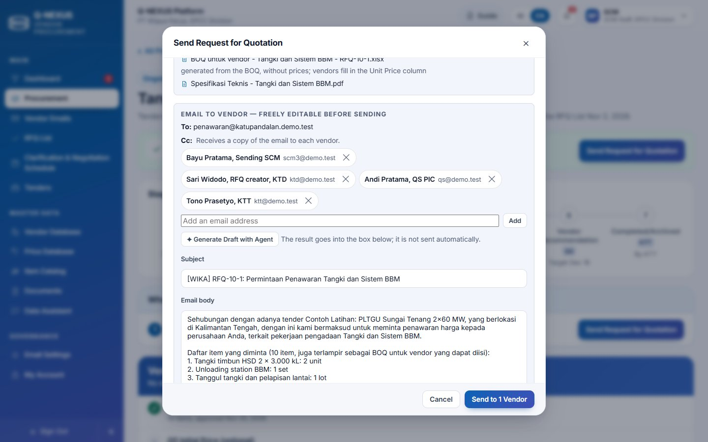

Left: Send Request for Quotation: category Mekanikal & Pompa plus the item search "pompa" leave 13 of 37 vendors, two ticked. · Right: The same window further down: the letter to the vendor with the tender team prefilled as Cc.

### 6. Recording and reading vendor offers

Replies are recorded against deadlines and against the BOQ revision they answer. Offers can be read from the vendor's own file instead of retyped: Excel by code, PDF and Word by an AI agent whose numbers must appear in the document.

- Late replies, missing replies and declined quotations are marked per vendor
- Excel offers are mapped by column headings in code, with no AI
- Side-by-side source and result, arithmetic check, and nothing saved until a person presses Save

Quotations after the deadline: lowest offer, a late reply and vendors with no response.

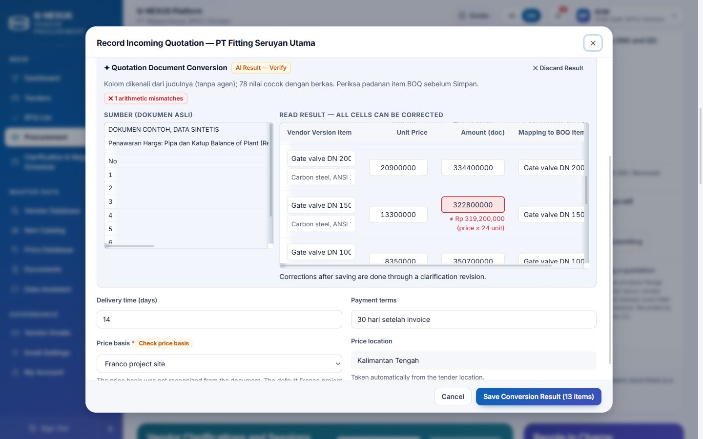

Reading a synthetic Excel offer: columns recognised without AI, one arithmetic mismatch flagged.

### 7. Technical and commercial evaluation

Engineering judges specification compliance without seeing prices; QS judges the price. A quotation becomes FINAL only when both gates are met. The technical evaluation matrix scores each item per vendor and produces the TBE score used later in the recommendation.

- Technical Evaluation page lists quotations awaiting the engineer, with no price columns
- TBE matrix: Comply 100, Comply with Note 1 to 99 with a required note, Not Comply 0
- TBE score per vendor appears once all items are scored
- FINAL requires Meets Spec and Reasonable, enforced in the database

Engineering's Technical Evaluation page: quotations awaiting assessment, no prices shown.

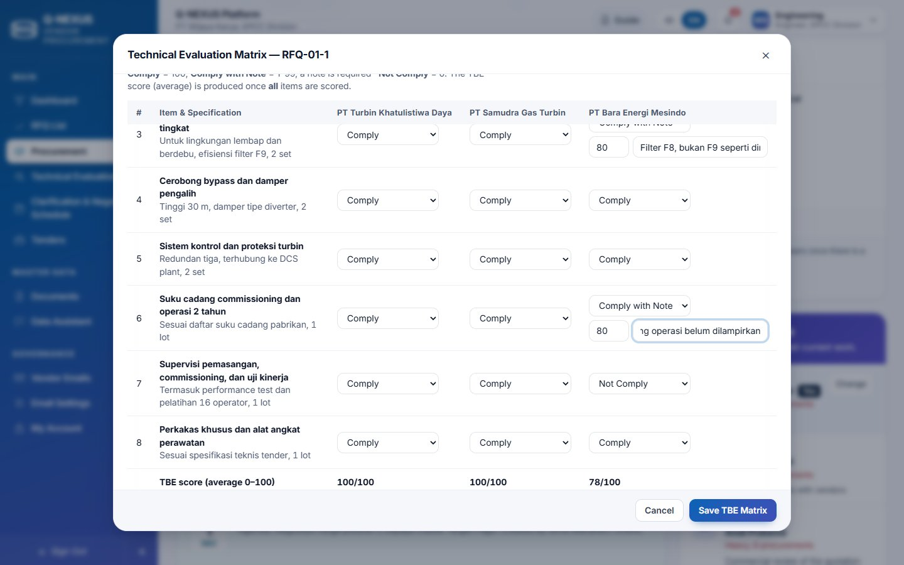 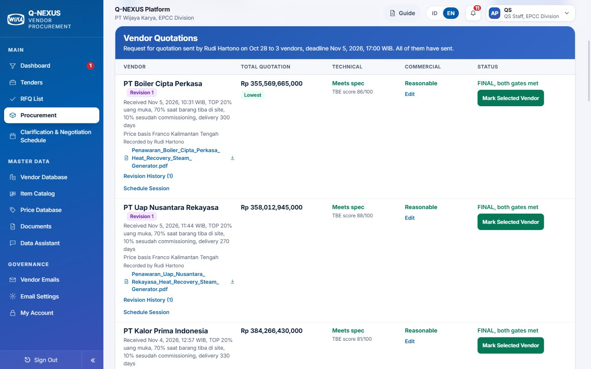

Left: Technical evaluation matrix for three vendors, with the average TBE score per vendor. · Right: Quotations that passed both gates: Meets spec, Reasonable and FINAL, ready to select.

### 8. Clarification and negotiation

All letters to vendors go through SCM. Engineering or QS drafts a clarification, SCM reviews and sends it, and the answer reopens the evaluation. Sessions with vendors are scheduled in one calendar, and every negotiation round is recorded and validated by QS.

- Clarification drafts wait for SCM, with a default answer deadline from the stage schedule
- Clarification and negotiation sessions in an agenda or week view, always in WIB
- Negotiation needs at least one FINAL quotation and a target or reason
- Each round shows the price before and after and the reduction

A clarification drafted by Engineering waiting for SCM, next to a scheduled session.

 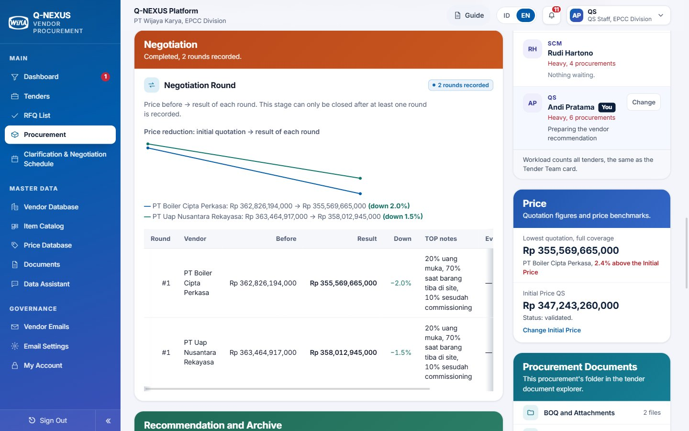

Left: Clarification and negotiation schedule with sessions that still need a result. · Right: Negotiation rounds with the price reduction per vendor, next to Initial Price and lowest offer.

### 9. Selected vendor and archive

The system recommends a vendor from FINAL quotations using 60% relative price and 40% TBE score. QS may mark a selected vendor, which can differ from the recommendation, with a reason that goes to the audit trail. The KTT closes the procurement with an explicit result.

- Recommendation text shows the relative price, TBE score and combined score
- Selected vendor prices are recorded as Selected in the Price Database
- Closing results: Completed, Failed, Canceled or Merged
- Reverse paths exist: repeat the RFQ, withdraw the selected vendor, reopen an archive

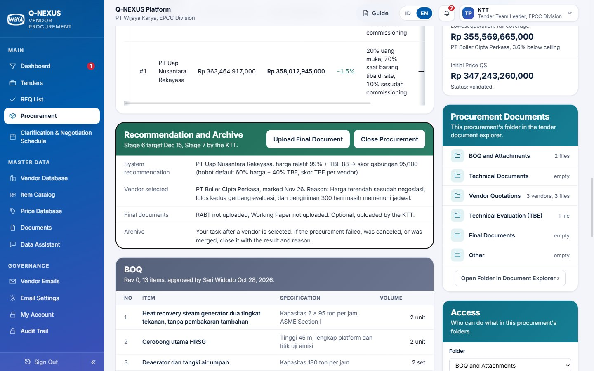

Recommendation and Archive: system recommendation, the vendor QS selected and its reason.

The KTT closing a procurement, with the four possible results and what happens next.

### 10. Price and vendor databases

The Price Database keeps unit prices from vendor quotations in the system and from past project contracts, so QS can check a price before trusting it. The vendor database is the source of RFQ recipients, with categories, umbrella contracts and a blacklist.

- Tender prices and project contract prices kept apart and filterable
- Latest price check with the tender versus project difference and a rough 6-month estimate
- Trend chart of the monthly median, optionally with vendor quotations
- Vendor database flags blacklisted vendors still in ongoing procurements and contracts about to end

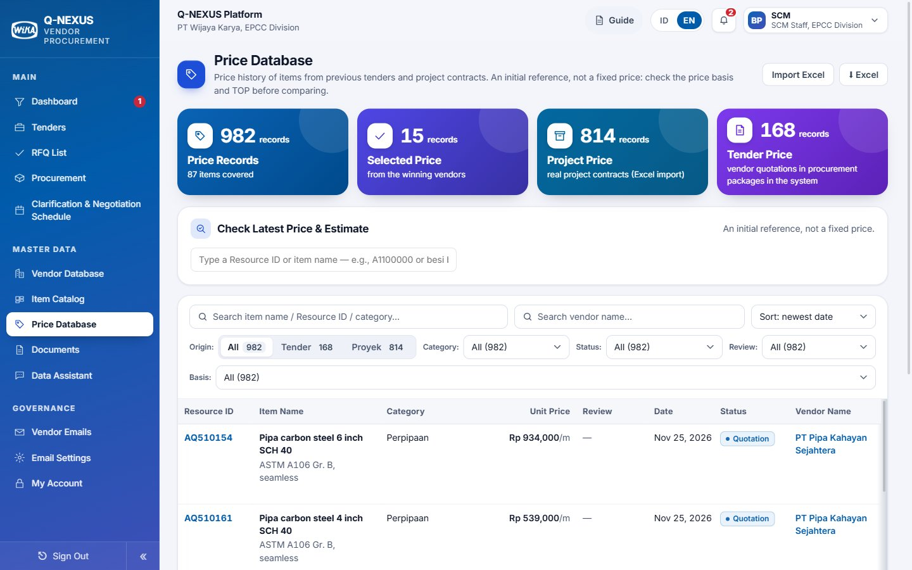

Price Database with synthetic records: totals by origin and the record list.

 

Left: Latest price check for one item: tender price, project price, difference and estimate. · Right: Price trend for one item, project contracts and vendor quotations as two series.

Vendor database: active, umbrella contract, incomplete and blacklisted vendors, with next actions.

### 11. Documents explorer

Every tender gets one folder tree: Tender Documents, then per procurement BOQ and Attachments, Technical Documents, Vendor Quotations, Technical Evaluation, Final Documents and Other. The explorer works like a shared drive: open, download, rename, move, see details, copy a link, create folders and delete to a Trash, with every action checked against the same rule on screen and on the server.

- Each folder states who fills it, who may open it and whether it is shared outside
- Rename, move and delete follow one rule: the uploader, the procurement PIC for the folders of their task, or a holder of extra delete access
- Move offers only folders of the same procurement or Tender Documents; folders of a different price nature are dimmed with the reason
- Folders made by people can be renamed, downloaded as .zip or deleted; system folders keep their names

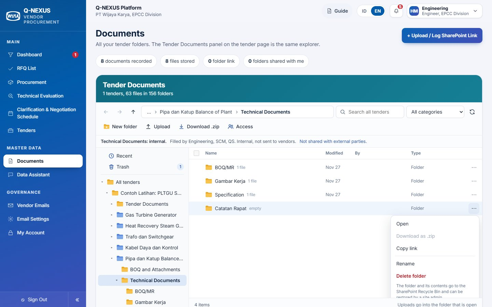

Technical Documents of one procurement, with its folders, the command bar and the access rule of the folder.

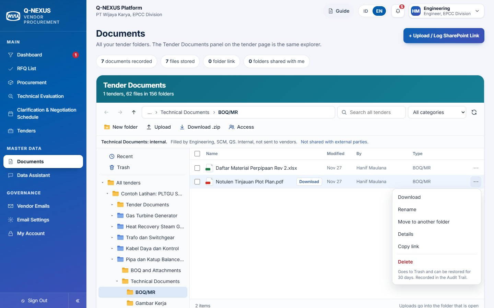 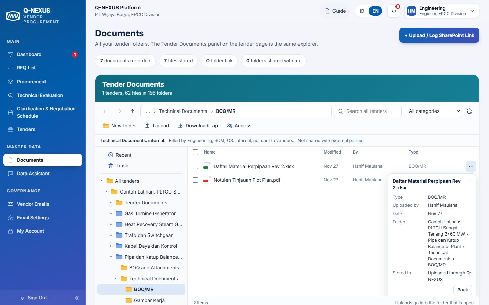

Left: File menu: download, rename, move, details, copy link and delete, which sends the file to Trash for 30 days. · Right: Details of one file: type, uploader, date, full folder path and where it is stored.

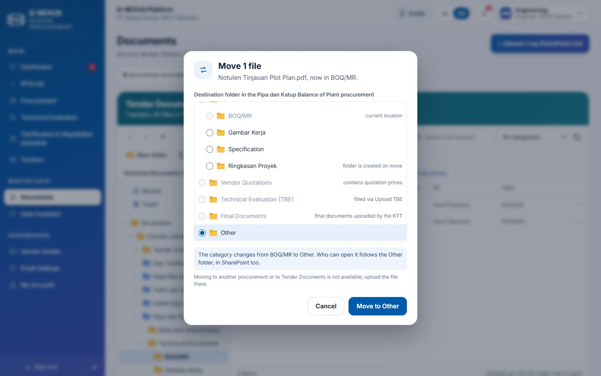

Moving a file: allowed folders, dimmed folders with their reason, and what changes after the move.

### 12. Selecting many, Trash, sharing and folder rules

Several files can be ticked at once; the bar says how many of them can be moved or deleted and why the rest stay. Deleted files wait in a Trash for 30 days and can be restored by whoever may still delete them. Folders are shared with named outside people for a limited time, and folders that may not be shared say why.

- Selection bar: Download .zip of the ticked files, Move n of m, Delete n of m, with the reason for files left behind
- Trash keeps files closed to downloads, Admin and the data assistant until they are restored or removed after 30 days
- Sharing: SCM shares with invited vendors, the KTT with the owner or consultants, view only or upload, with an end date
- Folders freeze when the tender stops running or the procurement is completed: download stays, changes are refused

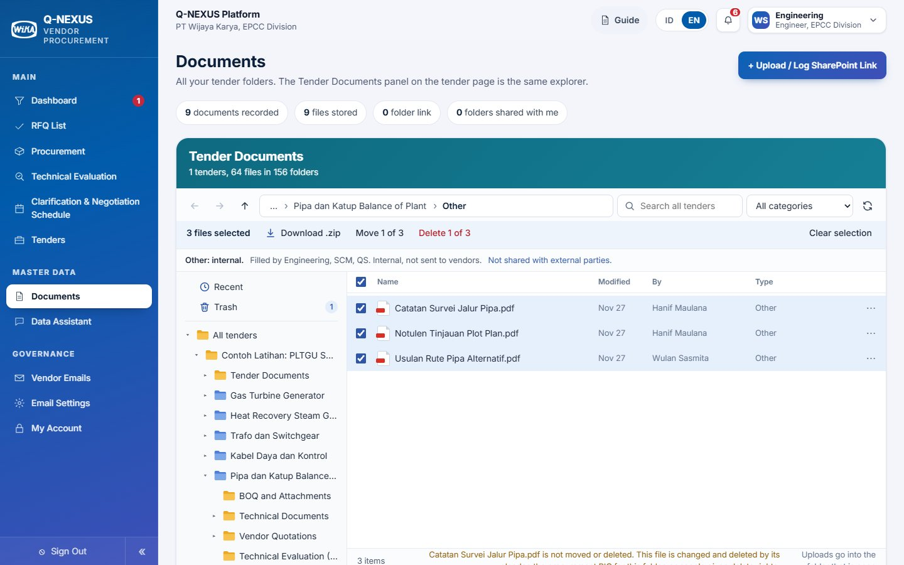

Three files ticked by an engineer who uploaded one of them: Move 1 of 3 and Delete 1 of 3, with the reason for the other two.

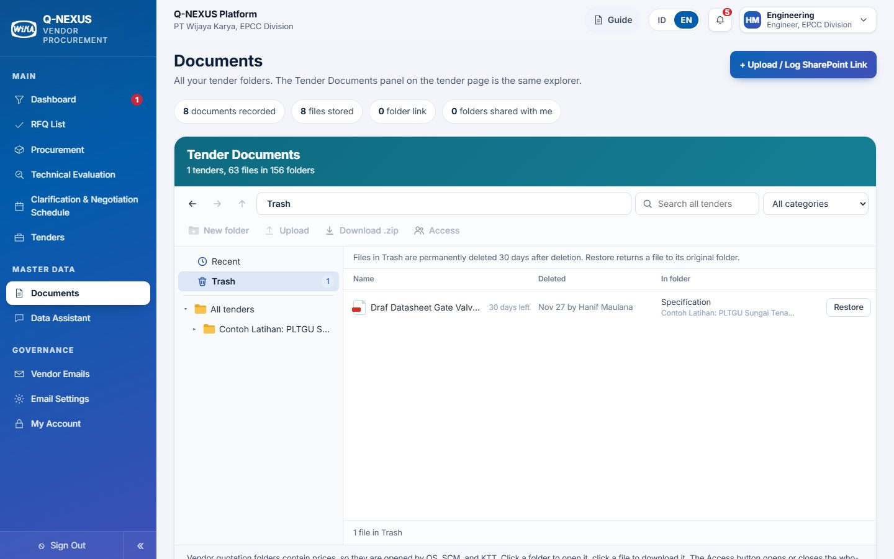 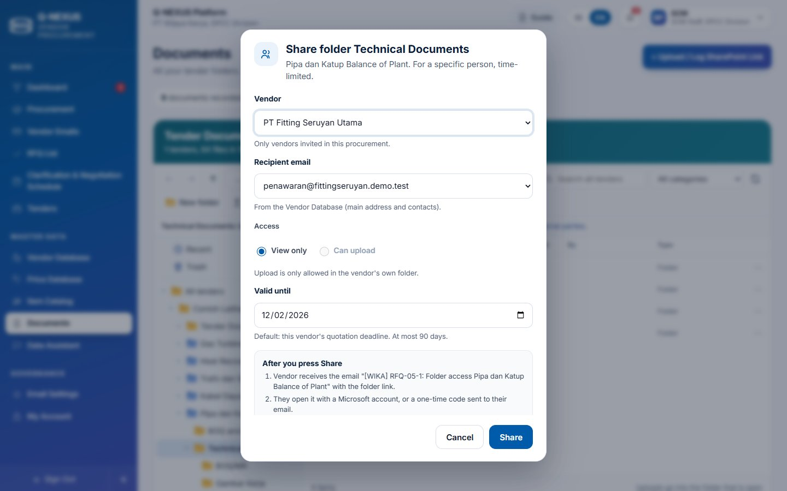

Left: Trash: a deleted file with the days left, who deleted it, its original folder and Restore. · Right: Sharing Technical Documents from the local Microsoft 365 mock: invited vendors, view or upload, and an end date.

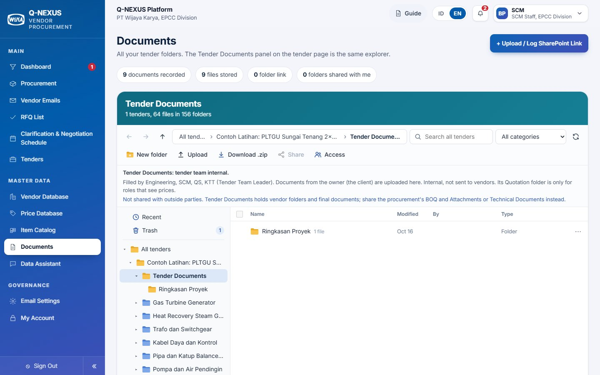 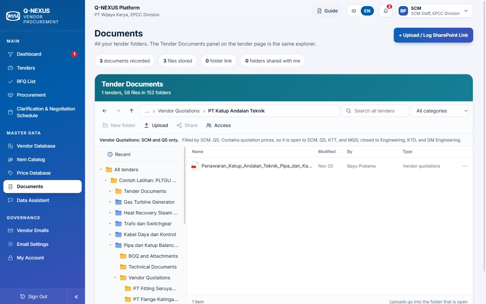

Left: Tender Documents cannot be shared outside, and the folder says why and what to share instead. · Right: A vendor quotation folder seen by SCM, with its access rule spelled out: closed to Engineering, KTD and GM Engineering.

### 13. Vendor letters, email settings and notifications

Vendor letters are composed by the system and kept in one outbox, even when sending is switched off. The Email Settings page says plainly where a person's letters leave from, based on the last letter actually sent, and the notification panel scrolls with its header fixed.

- Vendor Emails keeps every letter with its attachments and Cc
- Letters from an address outside the Microsoft 365 mailboxes leave from the procurement service mailbox, with vendor replies still going to the person
- Notification panel scrolls, stays above the sidebar, and fits a phone screen

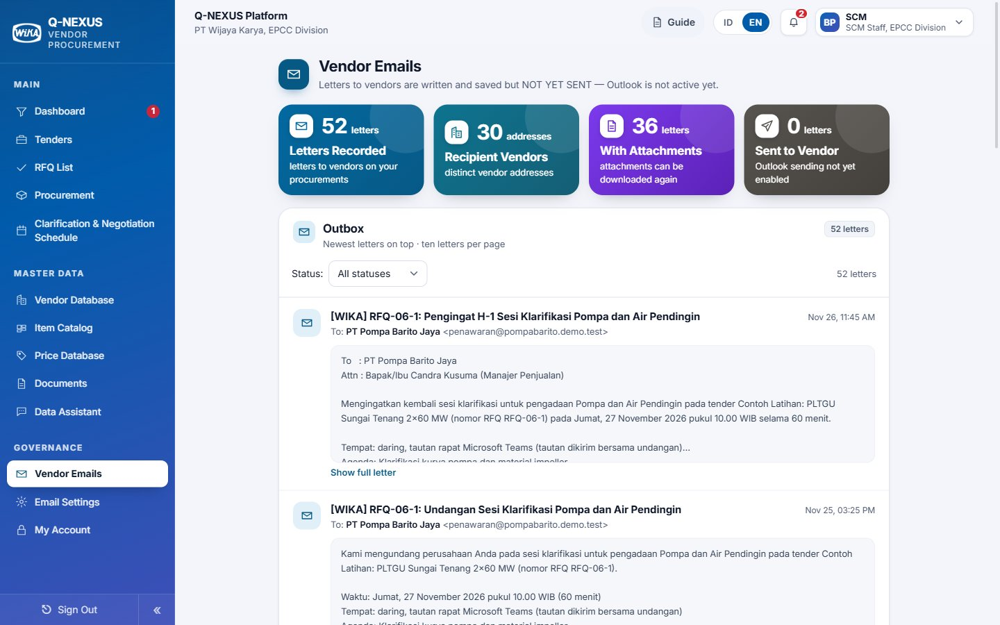

Vendor Emails outbox with invitation letters generated by the system.

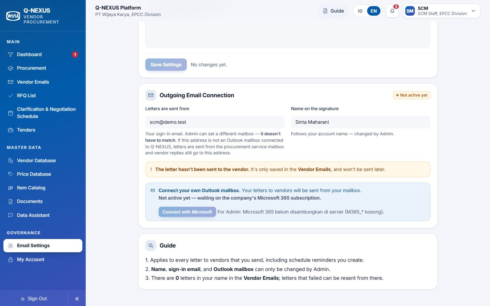 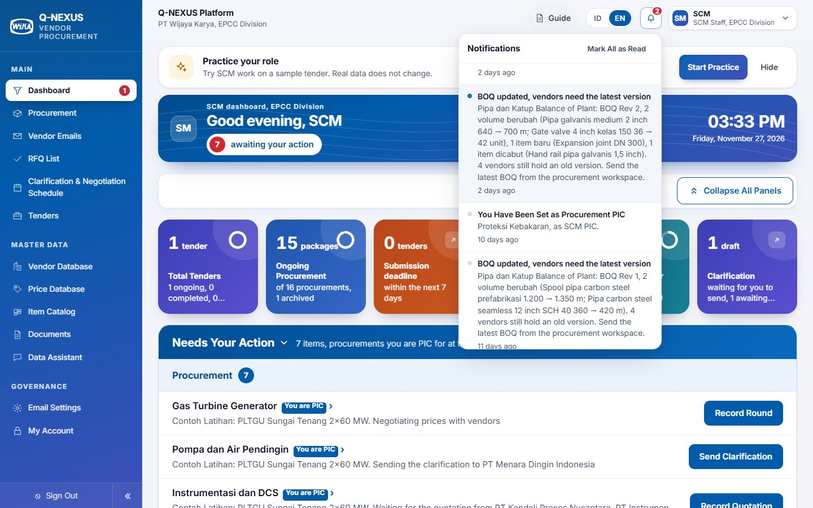

Left: Email Settings: where letters are sent from, explained for an account that has not sent yet (signature preview partly masked). · Right: Notification panel open over the SCM dashboard, listing BOQ updates and PIC assignments.

### 14. Accounts, role stacking and menus

Admin creates accounts and sets each person's primary role and any additional roles; every role except System Admin can be combined. The person switches the role in use from the name card, and every guard reads the role in use, while inside one tender a person holds exactly one role. The sidebar follows the daily work of the role in use.

- May also work as: KTT, MQS, GM Engineering, KTD, Engineering, SCM, Management, QS Coordinator
- An additional role cannot be removed while the person still holds an ongoing tender in that role
- Name card menu lists each role with what the person holds in it
- Extra folder access is judged by the role the person holds in that tender, so switching roles never widens it

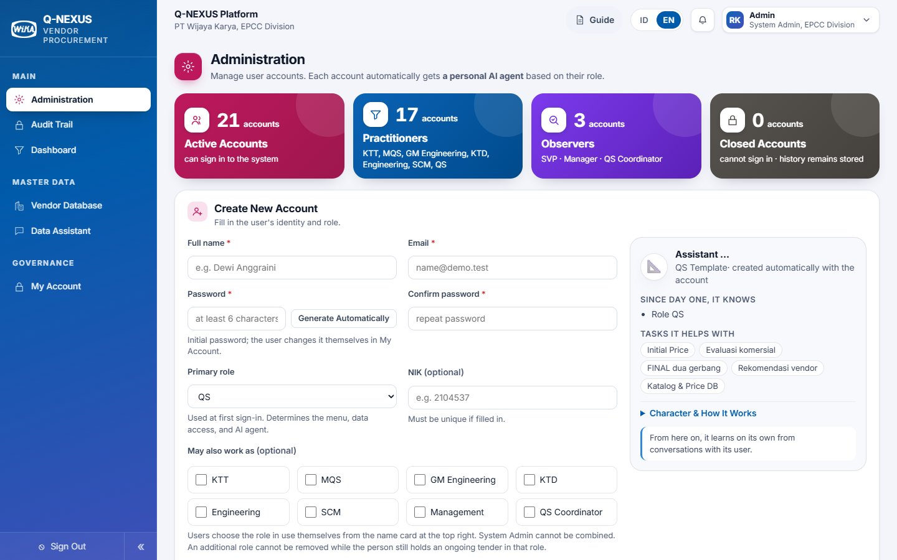

Administration: account counts by group and the new account form with additional roles.

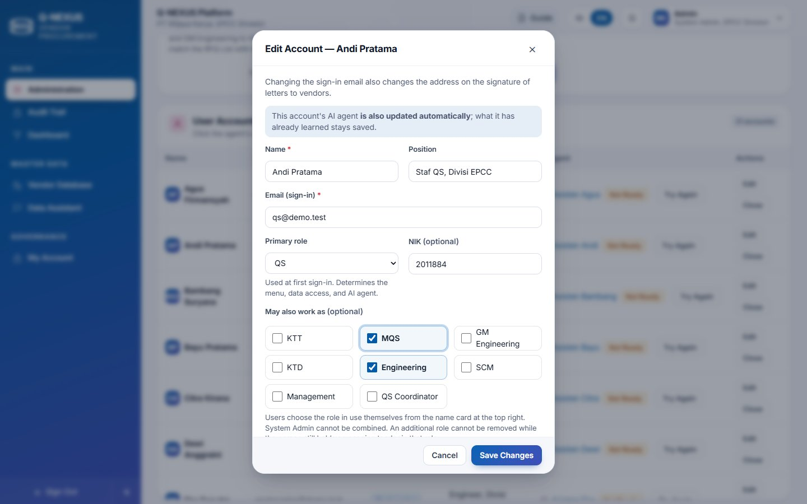 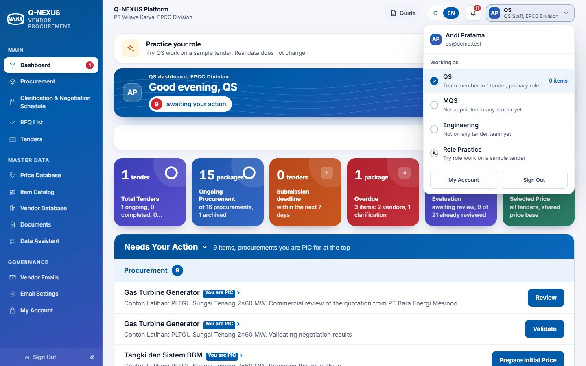

Left: Editing an account: a QS staff member who may also work as MQS and Engineering (ID number cleared for the capture). · Right: The same person's name card: QS in use, MQS and Engineering available, and Role Practice.

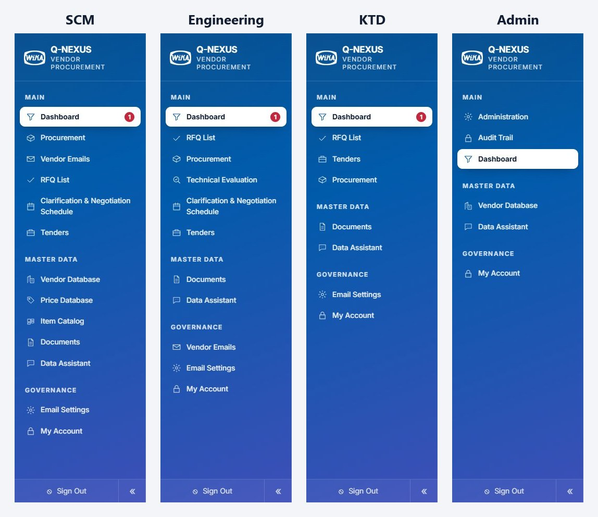

Sidebar order for SCM, Engineering, KTD and Admin, each following that role's daily work (four real captures side by side).

### 15. Data assistant, practice and oversight

Each user has a data assistant that reads the same data their screens show, read-only, and cites its sources. Practice Mode runs a fictional tender in the browser with a guide per role. Observers get a dashboard sized for a wall screen, Admin's governance dashboard folds like the others, and Admin reads an audit trail that cannot be changed.

- Assistant scope equals the user's scope; answers list their sources
- Practice Mode: role switch, start over, guide steps that tick themselves
- Observer dashboard has no action buttons and enlarges on wall screens
- Audit trail groups process, technical and commercial decisions

Data assistant in Practice Mode (simulated answers from system data) listing RFQ reply status per procurement, with sources.

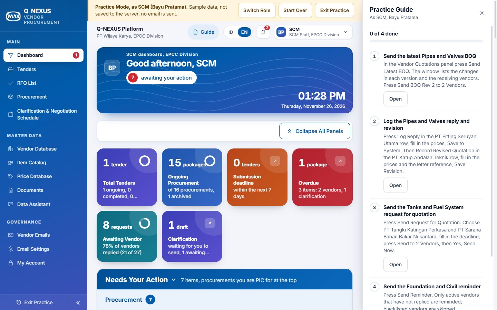 

Left: Practice Mode as SCM, with the practice guide listing the role's steps. · Right: Management overview at 1920 pixels wide, the wall-screen layout for observers.

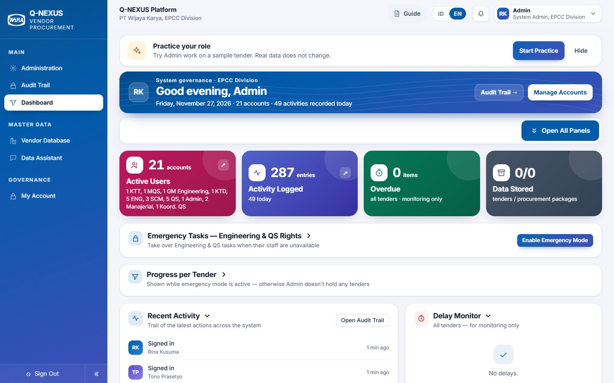 

Left: Admin's governance dashboard with three cards closed to their title and summary. · Right: Audit trail with counts per decision class and the latest actions, including a vendor selection.

## For developers

### Architecture

Q-NEXUS has three layers. The app is a React 19 single-page application built with Vite, TypeScript and Zustand, using a hash router so it runs from any static host. The API is Fastify 5 on Node.js with PostgreSQL through the pg driver. Between them sits a shared core, inti, that holds the business rules, types, access guards and formulas, and is compiled without browser or Node types so it can be imported by both sides.

Access guards return a decision with a sentence. The app shows that sentence as a message and the server returns it with HTTP 403, so the screen and the API can never disagree about who may do what. Guards are written as permissions, not prohibitions, so a new role is denied by default.

The app has two modes. Prototype mode keeps all data in the browser and is the target of the end-to-end suite. Server mode, switched on by one variable, replaces each store action with an API call while the pages stay the same. One read endpoint returns everything the caller may see in the same shape as the browser store, filtered by the shared scope rules, and the workspace reloads after every write instead of guessing optimistically.

Live updates use server-sent events that carry no data, only a heartbeat sent after each transaction commits. Clients react by reloading their own scoped workspace, so the scope rules are never written twice. The stream is read with fetch so the session token stays in a header, not in a URL.

Files go either into the database or into SharePoint under tender, procurement, section and vendor folders, chosen by one setting, and each row remembers where its file lives so storage can move gradually. Outbound letters are written to an outbox table inside the transaction and sent through Outlook after commit, with retries. A per-user AI agent reads data through a read-only MCP endpoint that the API itself serves.

Documents follow one rule set in the core. Rename and move reuse the delete rule, and a move goes to SharePoint first with conflict detection; the database row, the audit entry and the notice to the uploader then commit in one transaction, and the item is moved back if that fails. Deleted files go to a closed Trash folder for 30 days, because Microsoft Graph restores deleted items only on OneDrive Personal.

Role stacking keeps a single role in use. Admin sets a primary role and additional roles, the person switches from the name card, and every guard keeps reading the role in use. Inside a tender a person holds one role, stored on the team row, so access to price folders is judged by that tender role and never by whichever role happens to be switched on.

<picture><source media="(prefers-color-scheme: dark)" srcset="assets/architecture-dark.svg"></picture>

### Data model

<picture><source media="(prefers-color-scheme: dark)" srcset="assets/data-model-dark.svg"></picture>

### Key flows

<picture><source media="(prefers-color-scheme: dark)" srcset="assets/flow-1-dark.svg"></picture>

<picture><source media="(prefers-color-scheme: dark)" srcset="assets/flow-2-dark.svg"></picture>

<picture><source media="(prefers-color-scheme: dark)" srcset="assets/flow-3-dark.svg"></picture>

<picture><source media="(prefers-color-scheme: dark)" srcset="assets/flow-4-dark.svg"></picture>

<picture><source media="(prefers-color-scheme: dark)" srcset="assets/flow-5-dark.svg"></picture>

<picture><source media="(prefers-color-scheme: dark)" srcset="assets/flow-6-dark.svg"></picture>

### Security

- Every route passes a global authentication hook; agent tokens can only reach the read-only MCP endpoint.
- Passwords are hashed with scrypt and sessions are opaque random tokens stored as SHA-256 hashes, valid for 12 hours, so logout and deactivation take effect on the next request.
- Quoted prices are removed at the read layer for Engineering, the budget ceiling is visible only to the owning KTT, and original offer files stay out of Engineering's reach.
- Key rules are enforced by the database: one selected vendor per procurement, FINAL only with both evaluation gates, and an append-only audit table guarded by a trigger.
- Rename, move and delete reuse the delete rule on screen, in the store and on the server; observers, MQS and GM Engineering stay read-only, and folders freeze when the tender stops running or the procurement is completed.
- Extra folder access is judged by the role the person holds in that tender; while the person works in a role without prices, price folders stay closed in the app.
- Files in Trash are closed to downloads, Admin and the data assistant, and the Trash list is a separate route so it never reaches the agent's workspace.
- Folder access is derived from the file key and the tender team before content is accepted; SharePoint access is limited to one site.
- Inbound vendor mail that fails DMARC or SPF is queued for a person instead of being mapped automatically, and attachments are limited by type, size and count.
- CORS uses an allowlist, database errors are logged instead of returned, and the web server sets HSTS, nosniff, frame, referrer and permissions policies and a self-only content security policy.

### Quality

- CI on GitHub Actions runs against a PostgreSQL 18 service: type checks for server and core, core unit tests, all migrations from an empty database twice (the second run must find nothing new), a schema check against a golden schema file, lint, translation checks, the app build and database-free server tests.
- The shared core has 512 unit tests; all 512 passed when re-run locally for this showcase on 27 Nov 2026 at commit 5a43340.
- The end-to-end suite passed 189 of 189 scenarios in prototype mode on 10 Nov 2026 (tools/hasil-uji-v5.json).
- The schema is built by 61 plain SQL migrations, 78 tables after a run from an empty database, and cek-skema compares the live database with the golden schema so drift shows up.
- A dedicated checker verifies the read-only MCP tools and their scoping per role, and two translation checks keep every screen string wrapped for translation and present in the English dictionary.

### Deployment and operations

Production runs on one company VPS behind nginx with TLS: nginx serves the built app and forwards API calls to the Node.js server on the loopback interface, with PostgreSQL 18 and Node.js 26.

Releases come from a GitHub Actions workflow started by hand on main after CI is green; the deploy script builds, migrates, restarts and then proves the result with a health check, a test login and the build hash.

The production database is backed up daily at 02:30 WIB and backups are kept for 14 days.

Microsoft 365 provides document storage in SharePoint and vendor letters through Outlook; without it, files stay in PostgreSQL and letters stay in the outbox.

### Decisions

| Decision | Why |
| --- | --- |
| One shared core for app and API | Screen and server must never disagree about who may do what, and both explain a refusal with the same sentence. |
| Plain SQL migrations with a golden schema | Much of the design lives in CHECK constraints, partial indexes and triggers, which an ORM migration tool can drop silently; the schema check makes drift visible. |
| Opaque session tokens stored as hashes, not JWT | Logout and account deactivation must take effect on the next request, and a leaked database must not hand out live sessions. |
| Excel offers read by code, not AI | A model copying hundreds of numbers makes silent mistakes; the file is structured, so code moves the values and the path keeps working when the AI is down. |
| Every AI-read number must appear in the document | The model may only point at numbers, never compute them, because a computed figure would flow straight into the procurement decision. |
| One read-only agent per user over MCP | Identity comes from the token and scope equals the user's screens; decisions belong to people, so agents get no write tools. |
| Data-free live updates after commit | Filtering broadcasts per user would mean writing the scope rules a second time; clients reload their own scoped data instead. |
| Practice prices disguised with a secret salt | Practice data reaches every role's browser, including Engineering, so prices derived from real ones are scaled by a salted factor that cannot be undone from the code. |
| A Trash inside Q-NEXUS | Microsoft Graph restores deleted items only on OneDrive Personal, so deleted files move to a closed Trash folder for 30 days and are restored from the app. |
| One role in use, one role per tender | Every guard already reads the role in use, so stacking roles needed no second rule set, and access inside a tender never depends on which role is switched on. |

### Built with

<picture><source media="(prefers-color-scheme: dark)" srcset="assets/stack-dark.svg">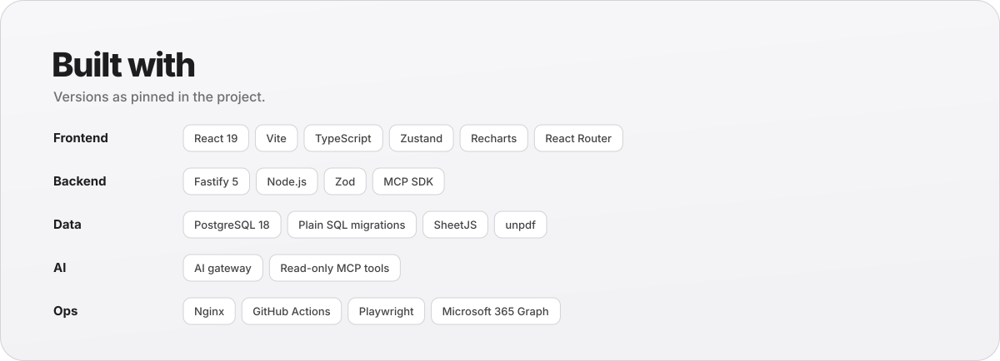</picture>

### Engineering highlights

- A number read from a PDF or Word offer is accepted only if it can be found in the document text.
- The business rules live in a shared core with no browser or Node dependency, so the app and the API apply the same logic.
- Passwords are hashed with scrypt and sessions use opaque tokens stored as hashes, so logging out revokes access at once.
- CI checks types, tests, a migration from zero against the reference schema, lint and the build against a real PostgreSQL.
- The audit trail is immutable and visible to admins only. Practice mode keeps training data apart from real prices.
- Rename, move and delete in the document explorer follow one rule on screen and on the server, deleted files wait 30 days in Trash, and folders freeze once a procurement closes.

## Related

- [HC Platform for Wijaya Karya](https://github.com/nugrahalabib/wika-hc-platform-showcase)
- [DashPro for Wijaya Karya](https://github.com/nugrahalabib/wika-pms-showcase)
- [Spead AI Pro for Wijaya Karya](https://github.com/nugrahalabib/spead-pro-wika-showcase)
- [All my work on GitHub](https://github.com/nugrahalabib)

---

Built by [Nugraha Labib Mujaddid](https://github.com/nugrahalabib). This page describes a private codebase; questions about the product or a demo are welcome at [nugrahalabib@gmail.com](mailto:nugrahalabib@gmail.com).
